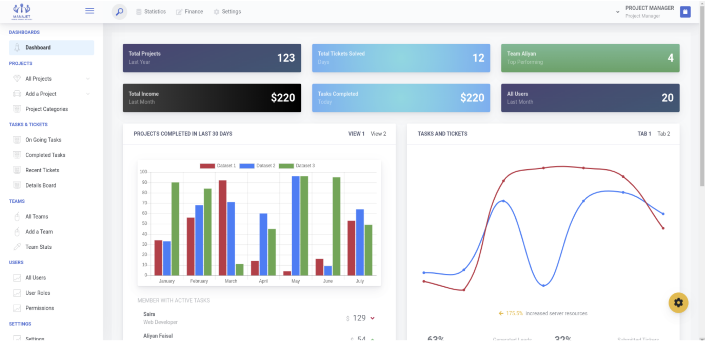
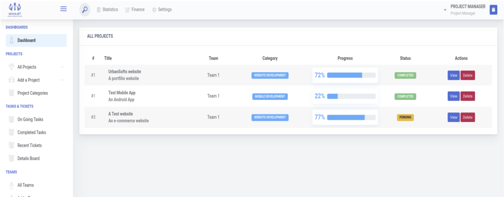
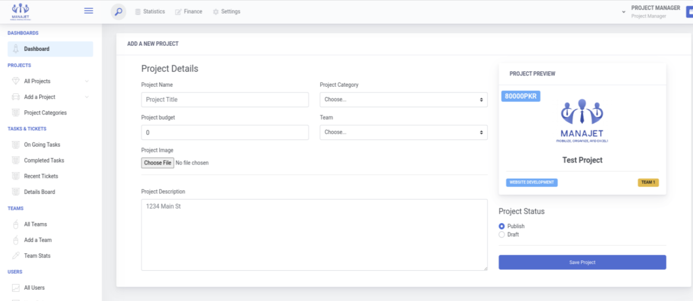
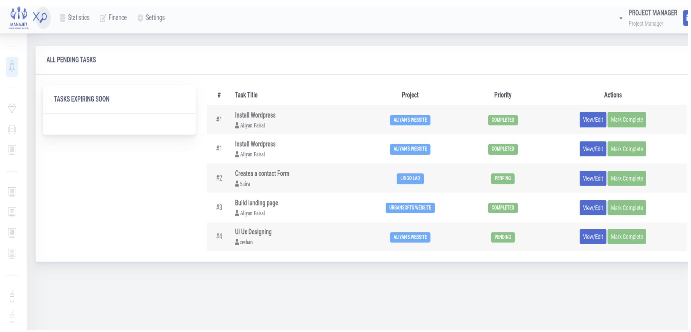
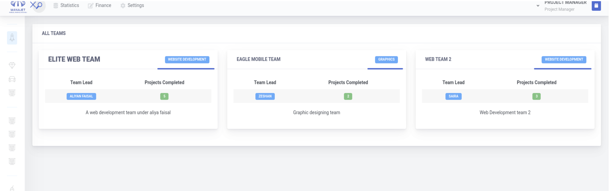
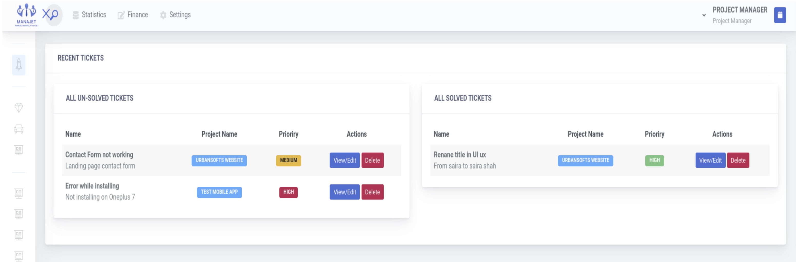

# ManaJet

### The AI-powered project management system built for IT companies

*Mobilize, Organize, and Excel.*

**Plan projects in minutes. Keep teams on track. Keep clients in the loop.**

[**Try the Live Demo**](https://aliyanfaisal.com/products/manajet) · [**Contact for Pricing**](#get-manajet-for-your-company)

---

## The problem

Software teams lose time and money in the same places:

- Project planning starts from a blank page every time.
- Tasks, deadlines and bug reports are scattered across chats, spreadsheets and inboxes.
- Clients keep asking *"where are we on this?"*
- Enterprise tools like Jira and Asana are heavy, expensive, and built for companies ten times your size.

## The solution

**ManaJet** puts planning, task tracking, team management, client communication and reporting in one clean system, made for small and mid-sized software houses. Its built-in AI assistant turns a project description into a ready-to-review task plan in seconds.

---

## AI project planning

Describe the project, add a few hints, and click **Auto Generate Tasks**. ManaJet asks OpenAI to draft an Agile-style plan. Each suggested task comes with:

- a clear **name and description**
- a **priority** (high, medium or low)
- an **estimated number of days**, which pre-fills the deadline

**You stay in control.** Nothing is added automatically. The manager reviews, edits and approves each task before it goes to the team.

| What you get | |
|---|---|
| A first draft of the plan in seconds, not hours | Consistent planning across all projects |
| Your own OpenAI account, so you control usage and cost | Switch the AI on or off any time from Settings |

---

## Everything your team needs

### Projects
Create projects with categories, budgets, cover images and assigned teams. Track live progress based on completed work, and view each project on a board.

### Tasks
Ordered task steps with deadlines, priorities, file attachments and a responsible owner. Work moves through **Pending → Under Review → Complete**, so nothing counts as done until the manager signs it off.

### Teams
Group developers into teams with team leads. Members see only the projects and tasks that belong to them.

### Tickets
Bugs and change requests are logged against a project or a specific task, with priority and deadline, and tracked in one place.

### Client portal
Every project gets a private secret key. Share it with your client and they get a **read-only view of their project's progress** and can raise tickets, with **no account or sign-up needed**. They see only their own project.

### Roles and permissions
Project Manager, Web Developer, Mobile Developer, Frontend, Backend, iOS, Android and Media Marketer roles come ready-made. Managers choose what each role can see and do.

### Communication
- **Team chat:** one-to-one messaging with file sharing.
- **Notice board:** company-wide announcements.
- **Notifications:** in-app alerts, plus **optional WhatsApp alerts** when projects, tasks or tickets are assigned.

### Analytics dashboard
Projects, pending tasks and tickets, income overview, best-performing team, tasks and tickets by priority, and monthly new and completed projects, all as live charts.

---

## Screenshots

| Dashboard | Projects |
|---|---|
|  |  |

| Project details | Tasks |
|---|---|
|  |  |

| Teams | Tickets |
|---|---|
|  |  |

---

## Who it's for

| | |
|---|---|
| **Software houses and agencies** | Run many client projects without losing track of any of them. |
| **Freelance teams** | Give clients visibility without giving them yet another login. |
| **In-house IT departments** | Plan, assign and report on internal projects. |
| **Startups** | Get structure early without paying for enterprise software. |

## Why ManaJet

- **AI built in** to planning, not bolted on.
- **Client transparency** without client accounts.
- **Lightweight** and focused on how software teams really work, with no feature overload.
- **Yours to own.** It runs on your own hosting with your own data, and there are no per-seat subscriptions.
- **Built on Laravel,** a mature, widely used PHP framework that is easy to host and extend.

## Technology

Laravel (PHP) · MySQL · Blade, jQuery and Bootstrap · Chart.js · OpenAI API · Twilio (WhatsApp)

---

## Try the live demo

See ManaJet running with real data: the AI task planner, the client portal, teams, tickets and the analytics dashboard.

👉 **[aliyanfaisal.com/products/manajet](https://aliyanfaisal.com/products/manajet)**

Want a guided walkthrough with the person who built it? Email **[aliyanfaisal15@gmail.com](mailto:aliyanfaisal15@gmail.com?subject=ManaJet%20Demo%20Request)** with the subject *"ManaJet Demo Request"*, plus your company name and team size.

## Get ManaJet for your company

ManaJet is **available for purchase**. Get in touch to discuss licensing, setup on your own server and customization for your workflow.

📧 [aliyanfaisal15@gmail.com](mailto:aliyanfaisal15@gmail.com?subject=ManaJet%20Inquiry) · 💻 [github.com/aliyanfaisal](https://github.com/aliyanfaisal)

---

**ManaJet** · Designed and developed by [Aliyan Faisal](https://github.com/aliyanfaisal)
BS Information Technology, Karakoram International University

